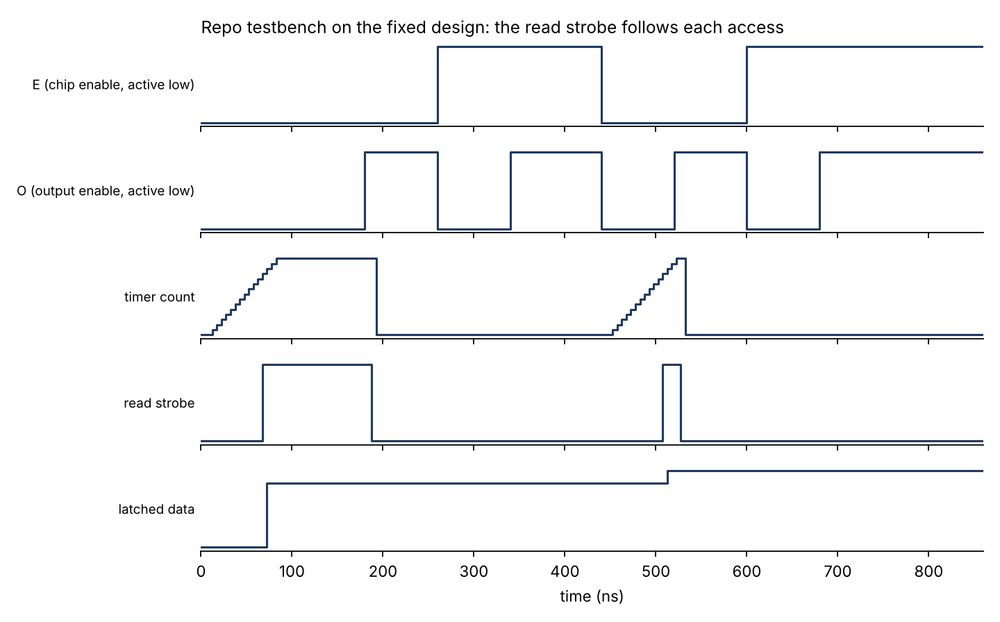
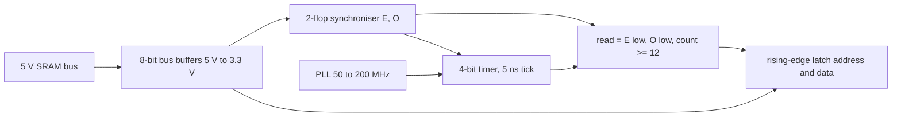
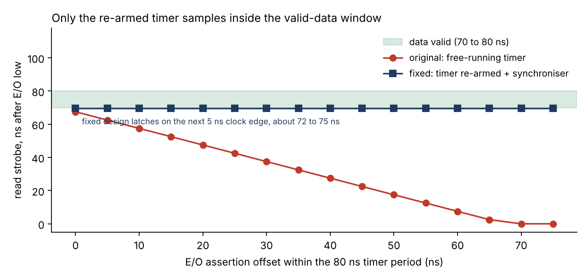

# SRAM_sampling

Passive capture of address and data from a legacy battery-backed SRAM (M48T35), on a MAX10 (DE10-Lite) FPGA. The SRAM only presents valid data for about 10 ns, roughly 70 ns after chip enable and output enable go low. The FPGA times that window with a 200 MHz clock and latches address and data inside it, without loading the bus.



## The problem

A legacy embedded control system boots from a non-volatile SRAM whose backup battery will eventually die, taking the boot and configuration data with it. The contents have to be read out without disturbing the host that owns the bus, which means sampling the address and data lines in step with the host's own accesses.

## Design



| Block | Choice | Why |
|---|---|---|
| Clock | PLL, 50 MHz to 200 MHz | 5 ns resolution on a 10 ns window |
| Timer | 4-bit, saturates at 15, held at 0 while E or O is high | Counts from the real start of each access and gives one strobe per access |
| Synchroniser | Two flops on E and O | E and O come from another clock domain; the timer and strobe never see a raw edge |
| Read strobe | E low, O low, count at least 12 | 12 ticks plus the two synchroniser cycles lands the latch at about 72 to 75 ns |
| Latch | Rising edge of the strobe | Address and data captured on the same edge |
| Interface | 8-bit bus buffers | 5 V SRAM side, 3.3 V FPGA I/O, no contention on the bus |

## Findings

Simulated with Icarus Verilog against a testbench that asserts E/O at 16 different offsets inside the timer period and drives valid data 70 to 80 ns later.

| Design | Offsets that latch the right data | Read strobe, ns after E/O low |
|---|---|---|
| Original (timer reset once at start-up) | 2 of 16 | 0 to 67.5, depends on timer phase |
| Fixed (timer re-armed per access, synchronised inputs) | 16 of 16 | 69.5, every offset |



The original timer ran freely, so the strobe landed wherever the timer happened to be when E/O dropped. The first version of the testbench hid this because it asserted E/O at t = 0, when the timer was aligned. A later access in the same testbench was captured only 27.5 ns after assertion, before the data was valid.

## Run the simulation

```bash
cd firmware/simulations/src
iverilog -g2005 -o sim sample_tb.v sample.v read.v read_data.v timer_5ns.v && vvp sim      # waveform dump
iverilog -g2005 -o sweep phase_sweep_tb.v sample.v read.v read_data.v timer_5ns.v && vvp sweep   # 16 of 16 check
```

For the board build, open `firmware/src/sample.qpf` in Quartus Prime Lite (device 10M50DAF484C7G). Setup notes are in [SETUP.md](SETUP.md).

## Limits

- Verified in simulation only. The synchroniser and the count of 12 are chosen from the simulated 70 to 80 ns window and have not been timed against the real SRAM on a board.
- Capture only: there is no output interface. `output_DATA` and `output_ADDR` are registered values for observation, and nothing transmits them.
- One access is latched per E/O assertion. Back-to-back accesses with E/O held low between them are not separated.
- The timing numbers assume the 70 ns access time quoted for this part.

## Layout

```
firmware/src/                 Quartus project and synthesisable sources
firmware/simulations/src/     testbenches and simulation copy of the top level
hardware/SRAM_interface/      KiCad 9 schematic and PCB for the level-shifting interface
```
